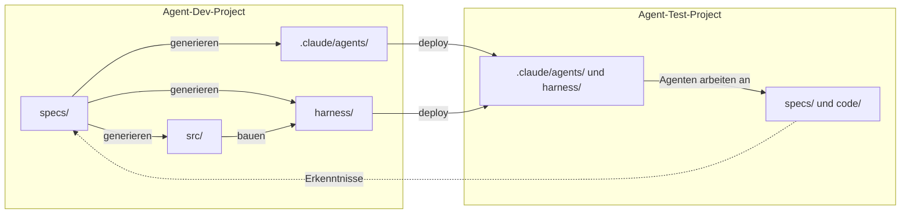

# Workshop: Architektur mit KI

Repository zum Workshop über die Entwicklung von Frontend- und Backend-Agenten für die Softwareentwicklung.

## Aufbau

| Bereich | Inhalt |
|---|---|
| [`Theorie/`](Theorie/) | Grundlagen: AI Intro, AI Basics, Agent.md und Subagenten, Richtlinien |
| [`Agent-Dev-Project/`](Agent-Dev-Project/) | Hier werden die Subagenten entwickelt: Specs, Agentendateien, Projekt-Config und Verifikationstools |
| [`Agent-Test-Project/`](Agent-Test-Project/) | Testprojekt, an dem die Agenten ausprobiert werden |

```
├── Theorie/
├── Agent-Dev-Project/
│   ├── specs/            Was macht ein Agent, wie macht er es, wie wird validiert
│   ├── .claude/agents/   Agentendateien: allgemeine Arbeitsweise, neutral zum Projekt
│   ├── harness/          Projektspezifische Config der Agenten
│   └── src/              Quellcode der Verifikationstools (Analyser, Lint-Configs ...)
├── Agent-Test-Project/
│   ├── .claude/          Agenten (per Deploy aus dem Agent-Dev-Project)
│   ├── specs/            Fachliche Specs der Testanwendung
│   ├── code/             frontend/ und backend/
│   └── harness/          _requirements.md und Projekt-Config der Agenten
└── deploy-agents.ps1     Kopiert Agenten und Projekt-Config ins Testprojekt
```

## So greift alles ineinander



1. **Spezifizieren** – In `Agent-Dev-Project/specs/<agent>/` wird festgelegt, was ein Agent macht, wie er arbeitet und wie seine Arbeit geprüft wird.
2. **Generieren** – Aus den Specs erzeugt der KI-Agent die Agentendatei (`.claude/agents/`), die Projekt-Config (`harness/`) und die Verifikationstools (`src/`).
3. **Deployen** – `deploy-agents.ps1` kopiert Agenten und Projekt-Config ins Testprojekt.
4. **Testen** – Im `Agent-Test-Project` setzen die Agenten echte Aufgaben um.
5. **Nachschärfen** – Was dabei auffällt, fließt zurück in die Specs.

Die Agentendateien enthalten nur die allgemeine Arbeitsweise. Alles, was ein konkretes Projekt betrifft, holt sich der Agent aus `harness/<agent>/`. Dadurch lässt sich derselbe Agent in einem anderen Projekt einsetzen, indem nur die Projekt-Config getauscht wird.

## Loslegen

Voraussetzungen: Git, [Claude Code](https://claude.com/claude-code) und PowerShell (für das Deploy-Skript).

Claude Code wird jeweils **im Projektordner** gestartet, nicht im Wurzelverzeichnis – nur dann werden die passende `CLAUDE.md` und die Agenten aus `.claude/agents/` geladen.

```powershell
# Agenten entwickeln
cd Agent-Dev-Project
claude

# Agenten ins Testprojekt übernehmen
cd ..
./deploy-agents.ps1

# Agenten testen
cd Agent-Test-Project
claude
```
